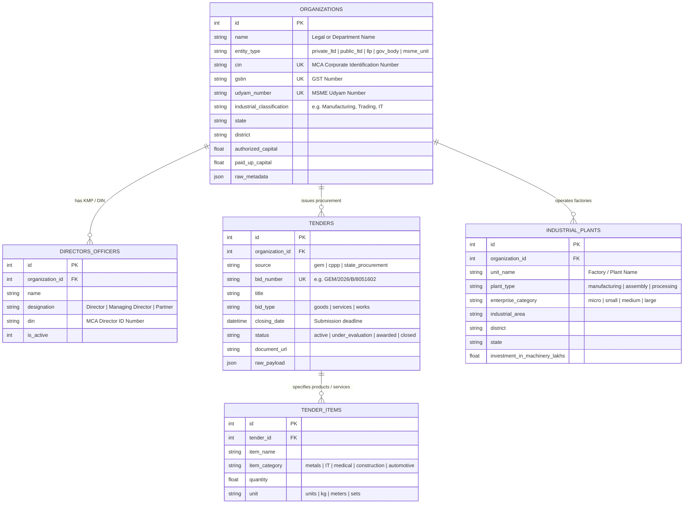

# Indian Business, Corporate & Public Procurement Intelligence Pipeline

An automated data collection, normalization, and intelligence engine designed to aggregate and structure openly available business, industrial, and procurement data across India.

The pipeline ingests raw records from open government platforms and public registries into a normalized **SQLite** database, retaining full raw JSON payloads while extracting structured entities across all economic sectors.

---

## 🎯 Core Objectives

- **Corporate Master Registry**: Track company & LLP incorporations, authorized/paid-up capital, status (Active/Dormant/Strike Off), and directors (DIN) from the Ministry of Corporate Affairs (MCA).
- **Public Procurement & Tenders**: Capture live government buying across all ministries and PSUs (bids, items, quantities, deadlines, and documentation) via GeM and CPPP.
- **Industrial & MSME Footprint**: Map physical manufacturing units, factories, and MSMEs (industrial areas, district-wise activity, enterprise categories) via Udyam and open data portals.
- **Sector-Agnostic Raw Data Lake**: Build an un-biased, queryable data layer suitable for any downstream B2B lead generation, market research, or trade analysis.

---

## 🏛️ Target Data Sources

| Source | Domain | Data Captured | Ingestion Method |
| :--- | :--- | :--- | :--- |
| **GeM (`gem.gov.in`)** | Central Public Procurement | Live bids, items, quantities, ministries, deadlines | Playwright Headless Chromium |
| **CPPP (`eprocure.gov.in`)** | Central & State Tenders | Active tender notices, departments, BOQ links | HTTP Scraper / Form automation |
| **MCA (`mca.gov.in`) / CDM** | Corporate Affairs | Companies, LLPs, CIN, capital, ROC, directors | Master data CSV dumps / Open datasets |
| **Udyam (`udyamregistration.gov.in`)** | MSME / Industrial Units | Registered manufacturing plants, districts, activities | data.gov.in bulk feeds / Smartboard |
| **Customs / Exim (HSN Codes)** | International Trade | Import/export shipments, domestic substitution signals | Exim customs databases |

---

## 📐 Normalized Database Schema (`data/pipeline.db`)

Built on SQLite with foreign keys, deduplication indexes, and complete raw JSON payload retention:



---

## 🛠️ Project Setup

### 1. Prerequisites
- Python 3.10+ (tested on Python 3.14)
- Git

### 2. Environment Setup
```bash
# Clone the repository
git clone https://github.com/Zaid-Yasin-919/data_idea.git
cd data_idea

# Create and activate virtual environment
python3 -m venv venv
source venv/bin/activate

# Install dependencies & Playwright browser
pip install -r requirements.txt
playwright install chromium
```

---

## 🚀 Running the Pipeline

### 1. Scrape Live Public Tenders (GeM)
Runs headless Chromium to bypass dynamic client-side rendering and collect live active bids:
```bash
python playwright_gem.py
```
Outputs raw captured records and screenshots to `data/`.

### 2. Ingest and Normalize Data
Parses raw GeM JSON scrapes, MCA corporate master CSVs, or Udyam industrial unit files into `data/pipeline.db`:
```bash
python ingest.py
```

### 3. View the Intelligence Report
Prints a structured summary of organizations, active tenders across sectors, line-item demand, and industrial units:
```bash
python report.py
```

---

## 📂 Project Structure

```text
├── README.md              # Universal data pipeline documentation
├── schema.sql             # 5-table sector-agnostic SQLite schema
├── db.py                  # Database connection, tables, and upsert helpers
├── ingest.py              # Multi-source ETL ingestion & normalization
├── report.py              # CLI business & procurement intelligence viewer
├── playwright_gem.py      # Playwright browser automation for GeM bids
├── scraper.py             # Early HTTP feasibility scraper
├── requirements.txt       # Python dependencies (Playwright, BeautifulSoup4, etc.)
├── .gitignore             # Ignored paths (venv, data/pipeline.db, logs)
└── data/                  # Local SQLite database & raw JSON dumps (local only)
```

---

## 🗺️ Roadmap

- [x] Dedicated project virtual environment & Git repo configured
- [x] Sector-agnostic 3NF SQLite schema implemented (`schema.sql`, `db.py`)
- [x] Playwright headless automation verified for GeM tenders (`playwright_gem.py`)
- [x] Ingestion and normalization pipeline active (`ingest.py`)
- [x] CLI intelligence reporting tool live (`report.py`)
- [ ] Add pagination and category filters to GeM/CPPP tender extraction
- [ ] Ingest state-wise MCA company master datasets (incorporations, status, capital)
- [ ] Ingest district-wise MSME industrial plant datasets from open government repositories


