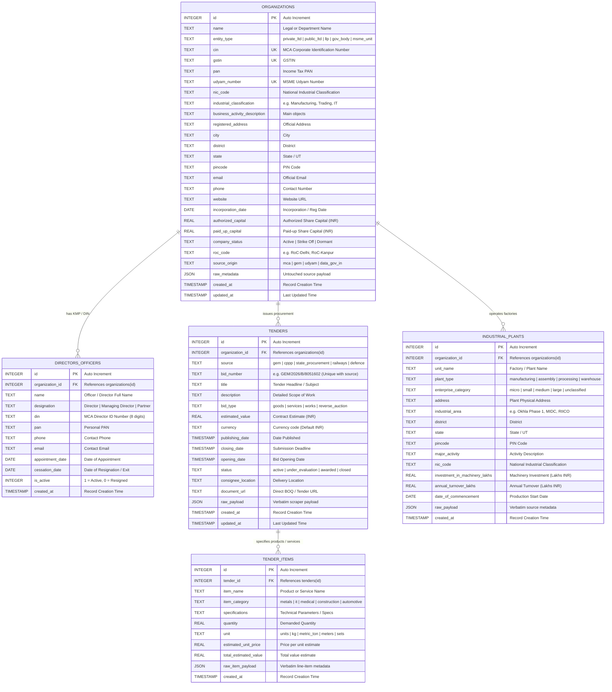

# Database Schema Documentation (`pipeline.db`)

Comprehensive technical documentation for the universal, sector-agnostic relational data model powering the Indian Business, Corporate & Public Procurement Intelligence Pipeline.

---

## 🏛️ Entity-Relationship Architecture



---

## 📋 Data Dictionary & Table Definitions

### 1. `organizations`
Master entity directory representing any legal, corporate, government, or industrial entity in India.

| Column | Type | Constraints | Description | Sample Value |
| :--- | :--- | :--- | :--- | :--- |
| `id` | `INTEGER` | `PRIMARY KEY AUTOINCREMENT` | Internal surrogate primary key | `1` |
| `name` | `TEXT` | `NOT NULL` | Legal or government department name | `Ministry of Defence` |
| `entity_type` | `TEXT` | `CHECK` | Category of organization | `'government_body'`, `'private_limited'`, `'llp'` |
| `cin` | `TEXT` | `UNIQUE` | 21-digit MCA Corporate Identification Number | `U74999DL2026PTC123456` |
| `gstin` | `TEXT` | `UNIQUE` | 15-character Goods & Services Tax ID | `07AAAAA0000A1Z5` |
| `pan` | `TEXT` | | Permanent Account Number | `AAAAA0000A` |
| `udyam_number` | `TEXT` | `UNIQUE` | MSME Udyam Registration Number | `UDYAM-UP-58-0012345` |
| `nic_code` | `TEXT` | | National Industrial Classification (NIC) | `25999` |
| `industrial_classification` | `TEXT` | | MCA industrial division / sector | `Manufacturing (Metals and Chemicals)` |
| `business_activity_description` | `TEXT` | | Objects of the company / activities | `Manufacture of metal containers and artware` |
| `registered_address` | `TEXT` | | Registered office / building address | `Plot 42, Okhla Industrial Area` |
| `city` | `TEXT` | | City / town | `New Delhi` |
| `district` | `TEXT` | | Administrative district | `South Delhi` |
| `state` | `TEXT` | | State or Union Territory | `Delhi` |
| `pincode` | `TEXT` | | Postal code | `110020` |
| `email` | `TEXT` | | Official contact email | `contact@company.in` |
| `phone` | `TEXT` | | Contact telephone / mobile | `+91-11-23000000` |
| `website` | `TEXT` | | Web address | `https://company.in` |
| `incorporation_date` | `DATE` | | Date of incorporation / registration | `2026-04-15` |
| `authorized_capital` | `REAL` | | Authorized capital in INR | `1000000.0` |
| `paid_up_capital` | `REAL` | | Paid-up share capital in INR | `500000.0` |
| `company_status` | `TEXT` | | MCA status | `'Active'`, `'Strike Off'`, `'Dormant'` |
| `roc_code` | `TEXT` | | Registrar of Companies jurisdiction | `RoC-Delhi` |
| `source_origin` | `TEXT` | | System source where first discovered | `'mca'`, `'gem'`, `'udyam'` |
| `raw_metadata` | `JSON` | | Full unparsed JSON dictionary from scraper | `{"raw_field": "val"}` |
| `created_at` | `TIMESTAMP` | `DEFAULT CURRENT_TIMESTAMP` | Ingestion timestamp | `2026-10-16 15:26:32` |
| `updated_at` | `TIMESTAMP` | `DEFAULT CURRENT_TIMESTAMP` | Last updated timestamp | `2026-10-16 15:26:32` |

**Indexes:**
- `idx_org_name`: Lookup by company/department name.
- `idx_org_state_dist`: Geographic filtering by `(state, district)`.
- `idx_org_classification`: Sector aggregation on `industrial_classification`.
- `idx_org_nic`: Filtering on `nic_code`.
- `idx_org_status`: Corporate health checks on `company_status`.

---

### 2. `directors_officers`
Tracks Key Management Personnel (KMP), Directors, and Authorized Signatories.

| Column | Type | Constraints | Description | Sample Value |
| :--- | :--- | :--- | :--- | :--- |
| `id` | `INTEGER` | `PRIMARY KEY AUTOINCREMENT` | Surrogate primary key | `1` |
| `organization_id` | `INTEGER` | `NOT NULL, FK` | References `organizations(id)` (CASCADE) | `1` |
| `name` | `TEXT` | `NOT NULL` | Full legal name of director / officer | `Rajesh Kumar Sharma` |
| `designation` | `TEXT` | | Designation / Role | `'Director'`, `'Managing Director'` |
| `din` | `TEXT` | | 8-digit Director Identification Number | `01234567` |
| `pan` | `TEXT` | | Director personal PAN | `ABCDE1234F` |
| `phone` | `TEXT` | | Contact telephone | `+91-9876543210` |
| `email` | `TEXT` | | Director contact email | `rajesh@company.in` |
| `appointment_date` | `DATE` | | Appointment date | `2021-08-10` |
| `cessation_date` | `DATE` | | Resignation / exit date | `NULL` |
| `is_active` | `INTEGER` | `DEFAULT 1` | `1` if currently active, `0` if resigned | `1` |
| `created_at` | `TIMESTAMP` | `DEFAULT CURRENT_TIMESTAMP` | Timestamp | `2026-10-16 15:26:32` |

**Indexes:**
- `idx_officer_org`: Find all directors of an organization.
- `idx_officer_din`: Search companies associated with a specific DIN.
- `idx_officer_name`: Name searches across directors.

---

### 3. `tenders`
Public procurement notices and bids across GeM, CPPP, and state procurement portals.

| Column | Type | Constraints | Description | Sample Value |
| :--- | :--- | :--- | :--- | :--- |
| `id` | `INTEGER` | `PRIMARY KEY AUTOINCREMENT` | Surrogate primary key | `1` |
| `organization_id` | `INTEGER` | `FK` | Issuing organization ID (SET NULL) | `1` |
| `source` | `TEXT` | `NOT NULL, CHECK` | Sourcing platform (`'gem'`, `'cppp'`) | `'gem'` |
| `bid_number` | `TEXT` | `NOT NULL` | Unique bid/tender reference code | `GEM/2026/B/8051602` |
| `title` | `TEXT` | `NOT NULL` | Bid title / brief description | `Supply of CI Castings` |
| `description` | `TEXT` | | Detailed scope of work | `Detailed specifications...` |
| `bid_type` | `TEXT` | `CHECK` | Category of procurement | `'goods'`, `'services'`, `'works'` |
| `estimated_value` | `REAL` | | Total tender value in INR | `2500000.0` |
| `currency` | `TEXT` | `DEFAULT 'INR'` | Currency code | `INR` |
| `publishing_date` | `TIMESTAMP` | | Date bid was published | `2026-10-05 10:00:00` |
| `closing_date` | `TIMESTAMP` | | Submission deadline | `2026-10-16 09:00:00` |
| `opening_date` | `TIMESTAMP` | | Bid opening date | `2026-10-16 09:30:00` |
| `status` | `TEXT` | `CHECK` | Lifecycle state (`'active'`, `'awarded'`) | `'active'` |
| `consignee_location` | `TEXT` | | Delivery city / state | `Kanpur, Uttar Pradesh` |
| `document_url` | `TEXT` | | Direct document link | `https://bidplus.gem.gov.in/...` |
| `raw_payload` | `JSON` | | Verbatim payload from scraper | `{"raw": "data"}` |
| `created_at` | `TIMESTAMP` | `DEFAULT CURRENT_TIMESTAMP` | Record creation time | `2026-10-16 15:26:32` |
| `updated_at` | `TIMESTAMP` | `DEFAULT CURRENT_TIMESTAMP` | Record update time | `2026-10-16 15:26:32` |

**Constraints & Indexes:**
- `idx_tenders_source_bid`: `UNIQUE(source, bid_number)` prevents duplicate bids across scraper runs.
- `idx_tenders_closing`: Fast filtering of upcoming deadlines.
- `idx_tenders_status`: Filter by `'active'`, `'awarded'`, or `'closed'`.

---

### 4. `tender_items`
Granular line-items, products, materials, and services demanded inside tenders.

| Column | Type | Constraints | Description | Sample Value |
| :--- | :--- | :--- | :--- | :--- |
| `id` | `INTEGER` | `PRIMARY KEY AUTOINCREMENT` | Surrogate primary key | `1` |
| `tender_id` | `INTEGER` | `NOT NULL, FK` | References `tenders(id)` (CASCADE) | `1` |
| `item_name` | `TEXT` | `NOT NULL` | Description of line-item | `C I CASTINGS G2 G3 G4` |
| `item_category` | `TEXT` | | Broad sector category | `'metals_machinery'`, `'it_electronics'` |
| `specifications` | `TEXT` | | Technical specifications / standards | `Grade G2, IS:210 standard` |
| `quantity` | `REAL` | | Demanded quantity | `15004.0` |
| `unit` | `TEXT` | `DEFAULT 'units'` | Measurement unit | `'units'`, `'pieces'`, `'kg'`, `'meters'` |
| `estimated_unit_price`| `REAL` | | Unit rate estimate | `120.0` |
| `total_estimated_value`| `REAL` | | Total line-item value | `1800480.0` |
| `raw_item_payload` | `JSON` | | Verbatim line-item JSON | `{"specs": {...}}` |
| `created_at` | `TIMESTAMP` | `DEFAULT CURRENT_TIMESTAMP` | Timestamp | `2026-10-16 15:26:32` |

**Indexes:**
- `idx_tender_items_tender`: Fast joining back to parent tender.
- `idx_tender_items_category`: Sector filtering (`'metals_machinery'`, `'construction_works'`).
- `idx_tender_items_name`: Text lookups across demanded products.

---

### 5. `industrial_plants`
Physical manufacturing units, factories, processing plants, and MSME industrial footprints.

| Column | Type | Constraints | Description | Sample Value |
| :--- | :--- | :--- | :--- | :--- |
| `id` | `INTEGER` | `PRIMARY KEY AUTOINCREMENT` | Surrogate primary key | `1` |
| `organization_id` | `INTEGER` | `FK` | References `organizations(id)` (CASCADE) | `1` |
| `unit_name` | `TEXT` | `NOT NULL` | Plant / Factory Name | `Unit 1 - Casting Division` |
| `plant_type` | `TEXT` | `CHECK` | Type of plant | `'manufacturing'`, `'assembly'`, `'processing'` |
| `enterprise_category` | `TEXT` | `CHECK` | Enterprise classification | `'micro'`, `'small'`, `'medium'`, `'large'` |
| `address` | `TEXT` | | Physical street address | `Plot 14, Sector 5` |
| `industrial_area` | `TEXT` | | Industrial estate / zone name | `Bhiwadi Industrial Area` |
| `district` | `TEXT` | | District | `Alwar` |
| `state` | `TEXT` | | State | `Rajasthan` |
| `pincode` | `TEXT` | | Postal PIN code | `301019` |
| `major_activity` | `TEXT` | | Operational description | `Metal casting and forging` |
| `nic_code` | `TEXT` | | NIC code | `24311` |
| `investment_in_machinery_lakhs` | `REAL` | | Plant & machinery investment | `85.5` |
| `annual_turnover_lakhs` | `REAL` | | Annual turnover in Lakhs INR | `320.0` |
| `date_of_commencement` | `DATE` | | Production start date | `2018-03-22` |
| `raw_payload` | `JSON` | | Verbatim Udyam / factory dump | `{"data": "..."}` |
| `created_at` | `TIMESTAMP` | `DEFAULT CURRENT_TIMESTAMP` | Timestamp | `2026-10-16 15:26:32` |

**Indexes:**
- `idx_plants_org`: Look up all plants owned by an organization.
- `idx_plants_state_dist`: Geographic filtering by `(state, district)`.
- `idx_plants_category`: Filtering by `enterprise_category` (`micro`, `small`, `medium`).
- `idx_plants_nic`: Industrial sector queries via `nic_code`.

---

## 🔍 Common Analytical SQL Queries

### 1. View Latest Active Tenders with Issuing Ministries
```sql
SELECT 
    t.bid_number,
    o.name AS issuing_ministry,
    ti.item_name,
    ti.item_category,
    ti.quantity,
    ti.unit,
    t.closing_date,
    t.document_url
FROM tenders t
JOIN organizations o ON t.organization_id = o.id
LEFT JOIN tender_items ti ON t.id = ti.tender_id
WHERE t.status = 'active'
ORDER BY t.closing_date ASC;
```

### 2. Aggregate Public Demand by Industrial Sector
```sql
SELECT 
    COALESCE(ti.item_category, 'unclassified') AS sector,
    COUNT(DISTINCT t.id) AS total_bids,
    SUM(ti.quantity) AS total_units_demanded
FROM tender_items ti
JOIN tenders t ON ti.tender_id = t.id
GROUP BY ti.item_category
ORDER BY total_bids DESC;
```

### 3. List All Companies by State and Capital
```sql
SELECT 
    name,
    cin,
    state,
    industrial_classification,
    authorized_capital,
    incorporation_date
FROM organizations
WHERE entity_type IN ('private_limited', 'public_limited', 'llp')
ORDER BY authorized_capital DESC;
```

### 4. Search Industrial Plants by State and Machinery Investment
```sql
SELECT 
    p.unit_name,
    p.industrial_area,
    p.district,
    p.state,
    p.enterprise_category,
    p.investment_in_machinery_lakhs,
    o.name AS parent_company
FROM industrial_plants p
LEFT JOIN organizations o ON p.organization_id = o.id
WHERE p.state = 'Uttar Pradesh'
ORDER BY p.investment_in_machinery_lakhs DESC;
```
